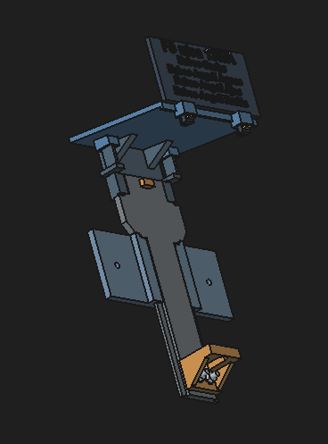

## The problem is perspective

As a software developer, I’ve heard for years that AI is the future. I kept looking for what that meant inside my own profession. New job titles like AI Engineer and Forward Deployed Engineer were popping up. Developers were trying Cursor, Codex, Claude Code, and whatever new tool came out that day. Some were building AI pipelines for a single step in software development, others for the whole process.

For a long time, I couldn’t see why any of that should matter beyond work. Then I spent a day building a game prototype and a few more days designing a replacement bracket for my doorbell. In both cases, I could try an idea while I was still excited about it.

## Create GTA VI. Make no mistakes.

About ten years ago, a good friend and I made two games. We barely made any money and eventually made them free. I’d wanted to make games since I was a kid, and getting to play something we’d built was worth it.

Making a video game is several jobs at once. There’s modeling, drawing, game design, sound, music, marketing, distribution. And then there’s the code. A dialogue system? Ugh. Input handling? If it’s lagging, at least I know it’s reacting. Don’t get me started on jumping.

Give me a bunch of points from a noise function and ask me to turn them into a mesh, though, and I’ll happily spend hours on it. Add a few more noise maps so I can play with frequency and amplitude? Even better. A terrain generator only gets you so far toward a playable game. Once I became a father, I put game development aside.

By 2026, I had Codex at a price I could justify, an Ollama subscription as a fallback, and local models good enough to use if I needed them. So why not try making a game from scratch again? And while I was at it, why not use Vulkan directly? Last time I tried that, I spent weeks working through a tutorial and getting past one problem after another. More than a thousand lines of code later, I drew a triangle.

This time I gave Codex the game concept and the technical constraints. It asked a couple of questions and got to work. I picked Rust for its memory safety, even though I’d never learned the language. By the end of the day, I could walk around a procedurally generated level running at a steady 60 FPS, with glass-like refraction, hundreds of lights, animated vegetation, and a few basic game mechanics.

<iframe src="https://www.youtube-nocookie.com/embed/ikJK_rzkAkM" title="Vulkan game prototype demo" width="560" height="315" style="display: block; width: 100%; height: auto; aspect-ratio: 16 / 9; border: 0;" loading="lazy" referrerpolicy="strict-origin-when-cross-origin" allow="encrypted-media; picture-in-picture" allowfullscreen></iframe>

[Watch on YouTube](https://youtu.be/ikJK_rzkAkM)

I’ve added more since then, but the first day changed how I thought about prototyping. I could decide what I wanted, talk through the details with Codex, then walk around the result and decide what to keep. Some ideas took minutes to try. That made it easier to drop the ones that didn’t work.

I still need to understand the generated code, especially when something breaks or needs optimizing. But for that first pass, I could spend more of my time figuring out what would make the game worth playing.

## A new bracket for my doorbell

The bracket holding my Tuya-based smart doorbell to the gate broke a few months ago. I have a 3D printer, so I kept thinking I could make a replacement. While I was at it, could I add a little roof to keep the rain off? What about a nameplate?

I’d done some CAD work before. Then I came across an integration that connects Codex to FreeCAD via the Model Context Protocol (MCP) and lets it build parametric models. Two or three days later, I was still in the same conversation. I’d describe a part, inspect the model, and ask for a change. Sometimes Codex suggested a change itself and walked me through how it would work.

For three days, I didn’t draw a line or edit the model by hand. When I had another idea, I could see it modeled in minutes. We kept each revision in a new file, so I could go back if a change caused trouble. The first test print is running as I write this. Soon I’ll find out how well the model fits the actual doorbell.

## Where are we heading?

I think we’ll see more software, services, and operating systems give agents ways to act on our behalf. That might be through MCP, as with FreeCAD, or through Agent2Agent (A2A), where one agent could ask another to handle a task inside a service.

I can imagine that helping with email, documents, inventory, shopping, or even hiring a plumber. For something like online banking, I’d want to see exactly what the agent plans to do and explicitly approve it before any money moves.

If these interfaces become common, software teams may spend less time building their own versions of the same integrations. There’ll still be plenty of work in handling the exceptions, deciding which steps need human judgment, and building for problems we haven’t run into yet.

I’m curious how much more we’ll try when it takes an afternoon to see if an idea works. I got to walk around a world I’d had in my head and send a part I needed to the printer. That’s the future I can picture now.
